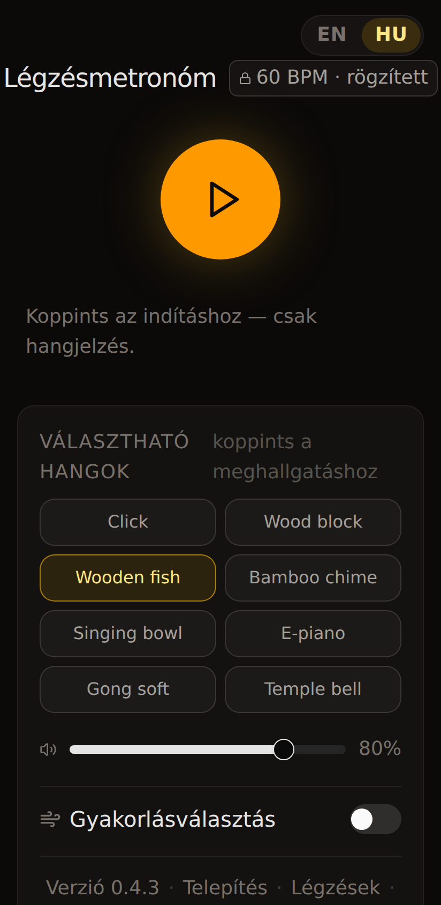
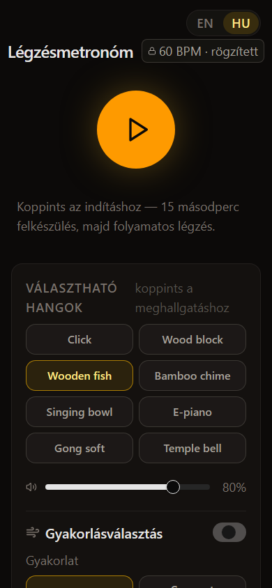
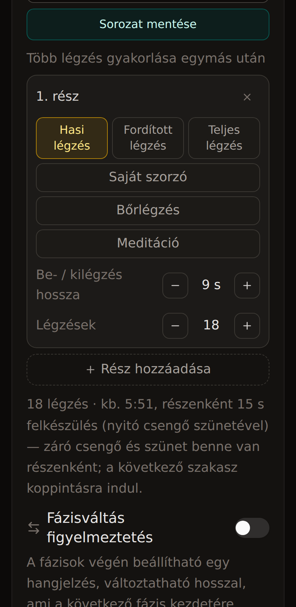

# Breath Metronome — légzés- és meditációs metronóm (PWA)

**Élő demo:** [breath-metronome-phi.vercel.app](https://breath-metronome-phi.vercel.app)

Egyoldalas, **offline-first** progresszív webalkalmazás: 60 BPM-es hangvezetés, több gyakorlási mód (hasi és teljes légzés, bőrlégzés, egyedi fázisok, meditáció), sorozatos edzések, gyakorlási napló és kétnyelvű felület (magyar / angol). Nincs szerver, nincs fiók — az adat a készüléken marad.

A fejlesztés forrásrepója (privát / fejlesztői): [htlearningacc/PROJ_metronom_cursor](https://github.com/htlearningacc/PROJ_metronom_cursor). Ez a repó csak **bemutató** (README + képernyőképek).

---

## Képernyőképek (412 px — telefon)

<table>
  <tr>
    <td width="33%" align="center"> Fő képernyő, indítás előtt</td>
    <td width="33%" align="center"> Gyakorlásválasztás: folyamatos módok</td>
    <td width="33%" align="center"> Sorozat: mentés és részek</td>
  </tr>
</table>

---

## Mit tud az app?

- **Gyakorlásválasztás** — folyamatos vagy időzített **sorozat**; módszerek: hasi, teljes légzés, saját szorzó (fázisonkénti idő, 0 s szünet = kihagyás), bőrlégzés, **meditáció** (nyitó/záró csengő, opcionális fa hal jelzések).
- **Web Audio** — fázis- és váltóhangok ütemezése lookahead schedulerrel (25 ms ciklus, ~150 ms előreütemezés); rögzített WAV csengők felkészüléshez és lezáráshoz.
- **PWA** — telepíthető Android Chrome-ból; frissítés-jelzés és változásnapló anélkül, hogy gyakorlás közben kényszerítené az újratöltést.
- **Gyakorlási napló** — helyi tárolás, export/import JSON, mentett sorozatok.
- **Béta transzparencia** — adatvédelem, egészségügyi figyelmeztetés a **Légzések** útmutatóban, visszajelzés mailto-val (verzió, nyelv, eszköz a sablonban).

---

## Technikai megoldások

| Terület | Megoldás |
|--------|-----------|
| **Keretrendszer** | [Next.js](https://nextjs.org/) (App Router), egy route (`/`), statikus export / Vercel |
| **UI** | React, Tailwind — sötét, csendes téma; elsődleges layout **390 px** szélesség |
| **Hang** | Web Audio API — szintetikus harangok (E5/E4/A4 fázisok), G3 pluck váltásra; opcionális tick WAV |
| **Időzítés** | `AudioContext` óra, fix 60 BPM; slot-alapú fázis/váltás kurzor — a scheduler szabályai termék-szintű kontraktus |
| **Állapot** | `localStorage` — nyelv, hangok, napló, sorozatok, verzió/frissítés kulcsok |
| **i18n** | Közös `Dict` interfész — minden új szöveg EN + HU páron |
| **Ellenőrzés** | ESLint, szótár- és meditáció-check scriptek, Playwright smoke 390 px-en |
| **Deploy** | Git push `main` → Vercel Production; build-time env a visszajelzés e-mailhez |

**Szándékosan nincs:** backend, adatbázis, analytics, hirdetés.

---

## Stack (rövid)

Next.js · React · TypeScript · Tailwind CSS · Web Audio · PWA manifest + service worker · Vercel

---

## Linkek

- **Demo:** https://breath-metronome-phi.vercel.app  
- **Forrás (fejlesztés):** https://github.com/htlearningacc/PROJ_metronom_cursor  

*Képernyőképek: production build, Chromium 412×844, 2026.*
